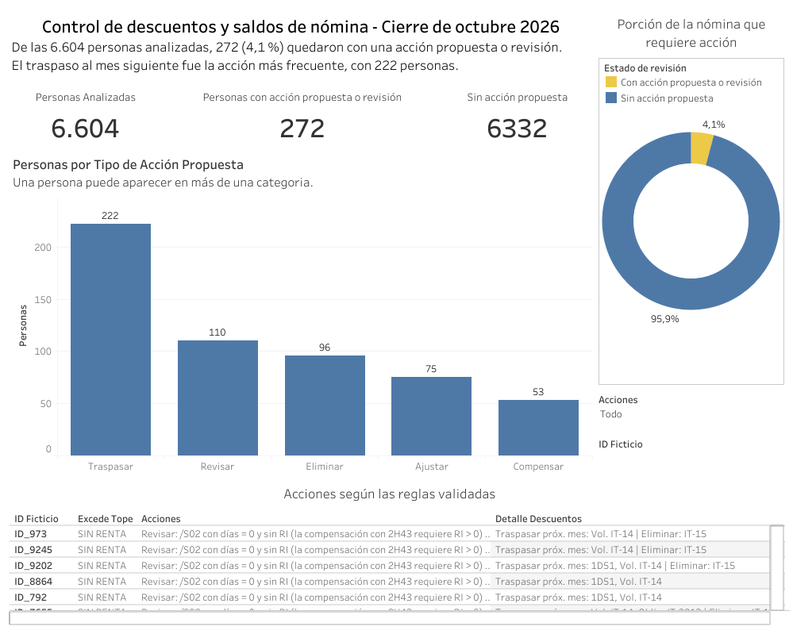

# 📊 Payroll Analytics | Control de descuentos y saldos de nómina

**Python · pandas · NumPy · Excel · Tableau**

Proyecto aplicado al análisis de remuneraciones, enfocado en automatizar la identificación de escenarios, validación de descuentos y cálculo de saldos, fortaleciendo la calidad de los datos y la eficiencia del proceso.

## 🎯 Objetivo del proyecto

Optimizar la revisión de descuentos y saldos de nómina mediante una solución automatizada que permita identificar excepciones, aplicar reglas de negocio y generar información confiable para apoyar las decisiones antes del cierre de remuneraciones.

## 🔎 Problema de negocio

La revisión manual de remuneraciones requiere aplicar múltiples filtros, clasificar escenarios y calcular saldos considerando distintos tipos de descuentos y límites aplicables.

Este proceso demanda tiempo, aumenta la exposición a errores manuales y dificulta el seguimiento de los casos que necesitan intervención.

**Preguntas clave:**

- ¿Qué registros presentan condiciones que requieren revisión o ajuste?
- ¿Qué acciones corresponden según las reglas de negocio definidas?
- ¿Cómo reducir el tiempo de procesamiento manteniendo controles sobre los resultados?

## 🛠️ Metodología y solución

Se desarrolló una solución en Python siguiendo cuatro etapas:

1. **Preparación de datos:** lectura del archivo, normalización de conceptos y validación de información.
2. **Aplicación de reglas:** clasificación de descuentos, evaluación de límites y cálculo de saldos según los escenarios definidos.
3. **Automatización:** identificación de excepciones y generación de un reporte con acciones sugeridas y saldos calculados.
4. **Validación y visualización:** corroboración manual de una selección de casos y construcción de un dashboard interactivo en Tableau para el seguimiento de resultados.

Las acciones generadas constituyen propuestas de revisión, ajuste o tratamiento y requieren corroboración antes de su ejecución.

## 📈 Resultados e impacto

| Indicador | Resultado |
|---|---:|
| Registros analizados | 6.604 |
| Casos con acción sugerida o revisión | 272 (4,1 %) |
| Casos sin acción sugerida | 6.332 (95,9 %) |
| Tiempo de identificación y cálculo manual en Excel | 70 minutos |
| Tiempo total automatizado en Python | 2 minutos |
| **Reducción del tiempo en las actividades comparadas** | **97,1 %** |

**Impacto operativo:** en la revisión medida, la automatización permitió reducir de 70 a 2 minutos la identificación, clasificación y cálculo de saldos, generando un reporte listo para su revisión y posterior registro.

La medición no incluye las verificaciones manuales posteriores ni la ejecución de ajustes en el sistema.

## 💡 Principales hallazgos

**1. Control focalizado de excepciones**

De los 6.604 registros analizados, 272 presentaron al menos una acción sugerida o necesidad de revisión, permitiendo concentrar los controles en los casos relevantes.

**2. Múltiples acciones por registro**

Se identificaron 556 asociaciones entre casos y categorías de acción. Un mismo registro puede requerir más de una intervención, por lo que las categorías no representan personas únicas.

**3. Eficiencia mediante automatización**

La aplicación automatizada de reglas de negocio redujo las tareas repetitivas de clasificación y cálculo, mientras que la revisión manual de una selección de resultados permitió corroborar las reglas evaluadas.

## ✅ Acciones y recomendaciones

- **Priorizar** la revisión de los casos identificados con alertas o acciones sugeridas.
- **Estandarizar** las validaciones para mantener criterios consistentes.
- **Corroborar** los resultados antes de registrar traspasos, ajustes, eliminaciones o compensaciones.
- **Monitorear** las excepciones mediante indicadores y visualizaciones que faciliten su seguimiento.

El proyecto demuestra cómo integrar conocimiento del negocio, automatización y análisis de datos para fortalecer los controles operativos.

## 📊 Dashboard interactivo | Tableau

[**Explorar Payroll Analytics en Tableau Public**](https://public.tableau.com/views/PayrollAnalyticsControldedescuentosysaldosdenmina/Dashboard1?utm_source=chatgpt.com)

El dashboard presenta indicadores de casos detectados, distribución de acciones sugeridas y detalles de revisión, utilizando información preparada para su visualización pública.

## 🔐 Privacidad de los datos

El proyecto se basa en un caso de uso aplicado a procesos de remuneraciones. La documentación y los archivos compartidos públicamente deben excluir identificadores personales, información salarial confidencial y datos internos sensibles.

Los ejemplos publicados deben utilizar datos sintéticos o adecuadamente anonimizados.

## 🎓 Conclusión

La combinación de experiencia funcional en remuneraciones y herramientas de análisis permitió transformar un procedimiento manual en un proceso automatizado y medible.

El principal aprendizaje fue que la automatización aporta valor cuando las reglas de negocio están documentadas, los resultados son verificables y la información generada facilita decisiones operativas.

---

**Desarrollado por Dayana Rodríguez**

Data Analytics | Business Intelligence | SQL | Python | Tableau | Data Quality

[GitHub](https://github.com/DayaRodriguezM) · [Portafolio](https://dayarodriguezm.github.io/)
